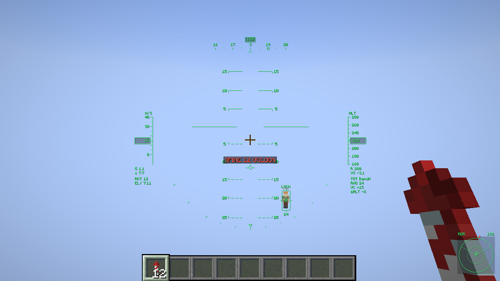
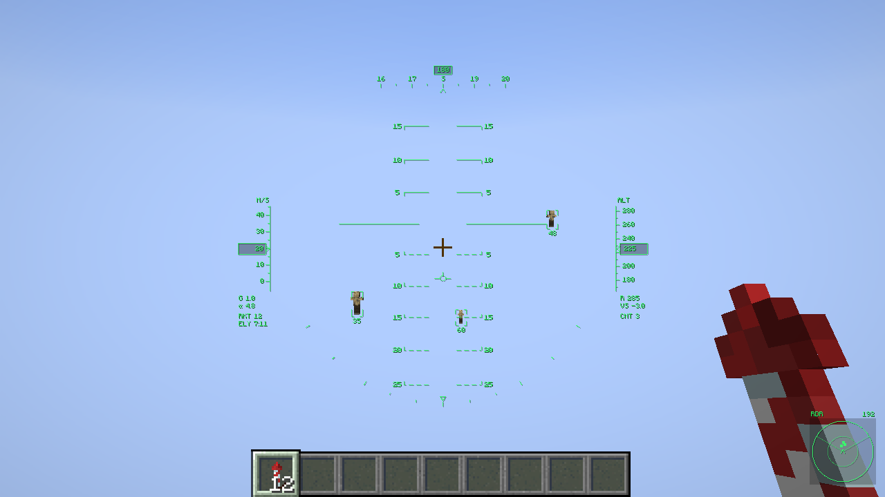
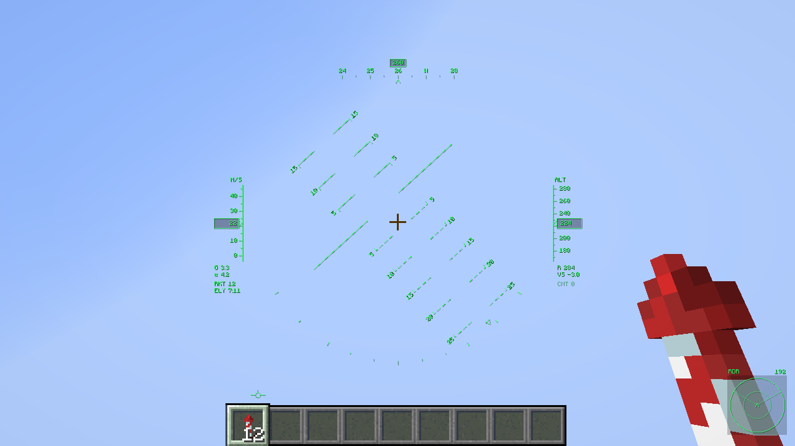
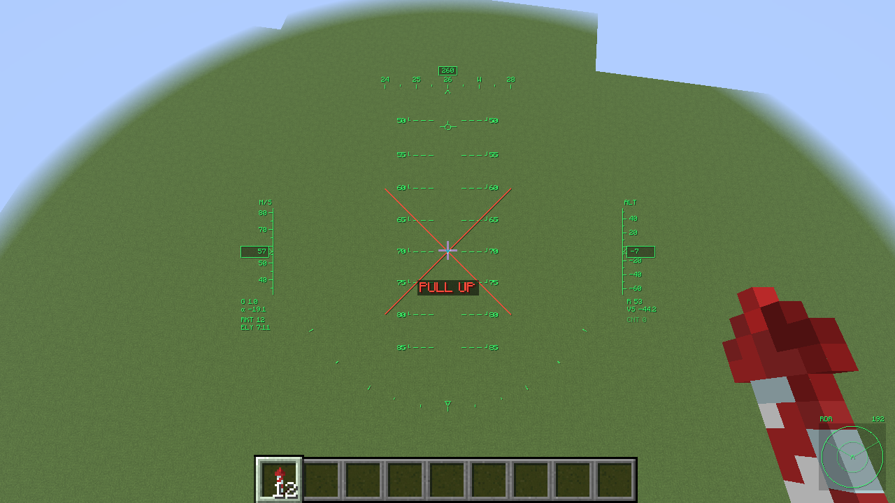

# Tally HUD

A fighter-jet head-up display for elytra flight. Client-side Fabric mod.

- **Minecraft:** 26.3 · **Loader:** Fabric 0.20+ with Fabric API · **Java:** 25
- **Optional:** Mod Menu (adds a "configure" button)
- **Download:** [Modrinth](https://modrinth.com/mod/tally-hud) or [GitHub releases](https://github.com/K0tatkoo/tally-hud/releases)
- **Name:** "tally" is the pilot's call for *target in sight*

The HUD comes on by itself when you start gliding and fades out when you land. It is purely
client-side: it works on any server, sends nothing, and never moves your view.

| | |
|---|---|
|  |  |
| A player locked, who is also aiming at you | Three contacts in the radar cone |
|  |  |
| The horizon in a hard right turn | Diving at the ground |

(Screenshots are from the automated test flight, at 1280×720 in a flat test world.)

## What is on the glass

| Where | What |
|---|---|
| Centre | **Horizon line and pitch ladder**, every 5° (10° at wide FOV). Solid rungs above the horizon, dashed below. They are projected through the game's own camera, so the horizon line lies on the real horizon at any FOV. |
| Centre | **Flight path marker**: the small winged circle. It shows where you are actually going, not where the nose points. Put it on the spot you want to reach. |
| Top | **Heading tape** with N/E/S/W, your heading boxed above it, and a bracket at the locked target's bearing. |
| Left | **Airspeed** tape and box (m/s, km/h or knots). Under it **G** (load factor) and **α** (angle of attack), then rockets left and elytra time left. |
| Right | **Altitude** (your Y level). Under it **R** (radar altitude: height above what is below you) and **VS** (vertical speed), then the locked target's name, range, closing speed and height difference. |
| Bottom | **Bank scale**: the pointer shows your bank angle. |
| Bottom right | **Radar scope**, nose-up, with the radar cone drawn on it. |

**Camera banking.** The view rolls into turns the way a coordinated turn would, so the horizon
tilts and levels out as you fly. Vanilla never rolls the camera, so without this the horizon could
only move up and down. Settings → *Camera banking* (0 % turns it off).

## Radar and lock

- Everything inside the **radar cone** (60° either side of the nose by default) that you have a
  **clear line of sight** to gets a bracketed box on the HUD with its range, and a blip on the scope.
  Nothing behind blocks is ever marked.
- **Left Alt** locks the target nearest your crosshair, with a lock tone. Press it again on the same
  target to let go; press it with the crosshair nearer another target to switch.
- A locked target gets a full box and its data on the right. If it leaves the screen, a line from
  the centre points the shortest way back to it, with the angle.
- If the target goes behind terrain, the box stays where you last saw it, marked `MEM`, and the
  lock is dropped after three seconds.
- **Aim point.** With a **bow, crossbow or trident** in hand, a circle with a dot shows where the
  shot has to go: it allows for the target's movement, the arrow's drop and drag, and your own speed
  (an arrow inherits it, which matters a lot from an elytra). With anything else in hand, a small
  circle marks a collision course. Either way it is only a symbol: you do the aiming.

What the radar can see is limited by the server, not by the range setting: your game only knows
about players the server sends it, usually those within 100 to 130 blocks.

## Warnings

All synthesised: tones generated, voice by a speech synthesiser (see Credits); no real aircraft
recordings. Every one can be switched off, and *Voice callouts* off replaces the voice with tones.

| Callout | When |
|---|---|
| "Terrain, terrain", then **"Pull up, pull up"** with a flashing X | Your flight path runs into something fast enough to hurt: a wall at more than 7 m/s, or ground while sinking faster than 10 m/s. A gentle landing or a dive into water stays silent. |
| "Altitude, altitude" | Once, as you sink below the low-altitude height (10 blocks). |
| Stall horn | Gliding slower than 7 m/s. |
| Chirp | A player you can see comes within the nearby radius (64 blocks), from any direction. They show as a tick on the rim of the scope. |
| Warble + `SPIKE 7 O'CLOCK` | A player in line of sight has kept their crosshair on you for half a second. |
| "Caution, caution" / "Warning, warning" | One minute / fifteen seconds of elytra left (Unbreaking is counted). |
| "Bingo, bingo" | Down to your last three rockets. |
| Lock tone, drop tone | Lock taken, lock lost. |

## Keys

| Key | Does |
|---|---|
| Left Alt | Lock / unlock target |
| J | Settings |
| (unbound) | Cycle HUD: auto / always / off |

Change them in Options → Controls → Key Binds → Tally HUD. Settings are also under Mod Menu, and
are saved in `config/tally_hud.json`.

## Building

```bash
./gradlew build                 # unit tests + build/libs/tally-hud-<version>.jar
./gradlew runClientGameTest     # boots a real client and flies a scripted test sortie
```

You need JDK 25. `runClientGameTest` opens a game window for about a minute and flies four scripted
sorties in a flat test world, asserting on the mod's state at each step: another player aiming at
you (contact, SPIKE, lock); three mobs (lock, the bow's aim point, and the view never moving, even
with a target locked); a wall going up between you and a target and a player hidden behind it (the
target is masked, the hidden player gives nothing away, the terrain warning fires); a hard turn and
a dive at the ground ("terrain", then "pull up"). Screenshots of each stage land in
`build/run/clientGameTest/screenshots/`.

The sounds and the icon are generated, not hand-made:

```bash
python3 tools/make_sounds.py                  # numpy, soundfile; the voice comes from tools/voice/public
python3 tools/make_icon.py                    # Pillow
```

The voice is stored as takes of the bare words in `tools/voice/public/`, so the callouts rebuild
exactly. `--new-takes --piper-model en_US-kristin-medium.onnx` (needs `piper-tts`) records new
ones; deleting one take re-records just that word. The committed takes were checked with a speech
recogniser (whisper.cpp), and each callout transcribes as its word.

## How it is put together

- `math/` has no game classes and is unit-tested: `Ballistics` (the firing solution, checked
  against a tick-by-tick copy of the game's arrow physics), `Gpws` (what counts as a dangerous
  impact), `Angles`.
- `flight/FlightState` samples the aircraft every tick. `radar/Radar` tracks contacts and the lock;
  `radar/AimPoint` works out the aim point the HUD draws. `audio/Warnings` decides what to say.
- `hud/HudRenderer` draws everything with the game's GUI rectangles and font.
- One mixin, on `Camera`: a per-frame hook and the roll. The roll is applied to the camera's own
  rotation, so culling and other renderers (Sodium, Iris) see the same view.
- Sounds are played from the mod's own `sounds.json` and never registered, so a vanilla server's
  registry check is not affected.
- The source tree can build more than one edition (`src/<edition>/`); this repository has the one
  edition, Tally HUD, in `src/public`.

## Credits

- Voice callouts: [Piper](https://github.com/OHF-Voice/piper1-gpl) text-to-speech with the
  `en_US-kristin-medium` voice by Bryce Beattie from
  [rhasspy/piper-voices](https://huggingface.co/rhasspy/piper-voices) (MIT), trained on public-domain
  [LibriVox](https://librivox.org) recordings, then filtered by `tools/make_sounds.py`.
- Written by Danny (K0tatkoo) with Claude, an AI model by Anthropic: the code is AI-generated.

## Licence

MIT, see [LICENSE](LICENSE).
